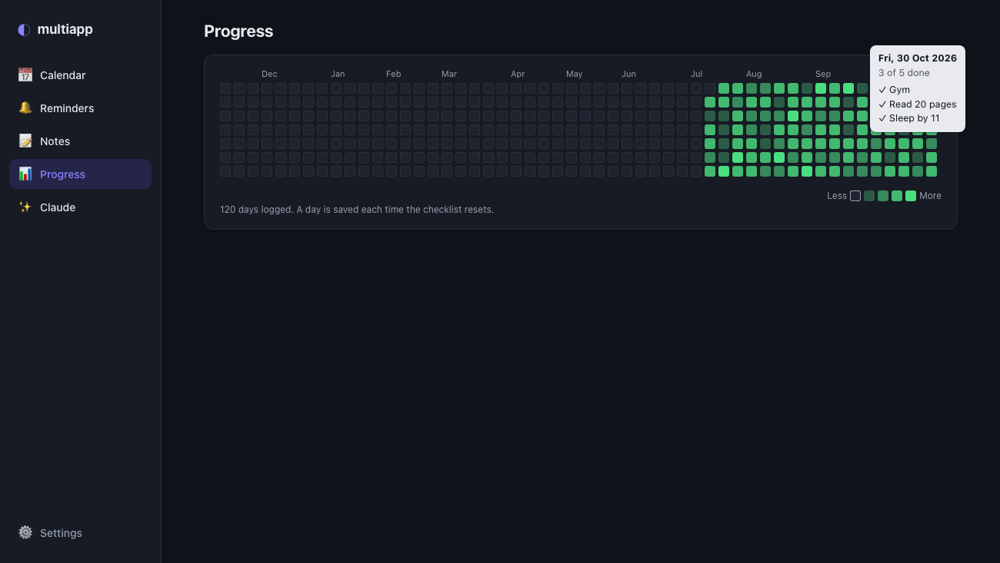
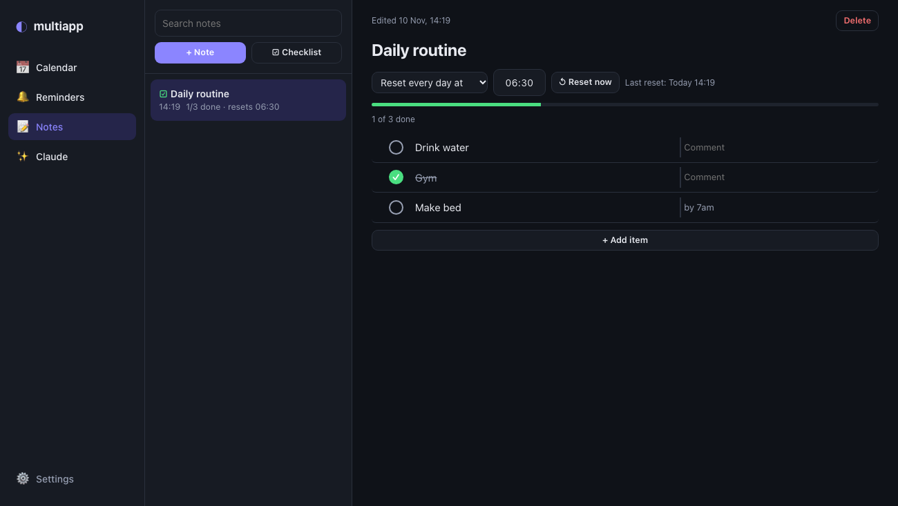

# multiapp

A personal planner that runs on your own laptop and starts at login. One app instead of three: a **calendar**, **reminders that get pushed to your phone**, a **notes app with daily checklists**, a **progress heatmap** of your habits, and an optional **Claude chat** that can add reminders and events for you.

Everything is stored locally in a SQLite file. There is no account, no cloud service and no build step.



## Features
- **Calendar**: month view with events, a note for each day, and a "coming up" list. Events can be deleted.
- **Reminders**: simple list with once / daily / weekly repeats and snooze. Pushed to your phone with [ntfy](https://ntfy.sh). Reminders missed while the laptop was asleep arrive as "Missed: …" when it wakes.
- **Events become reminders**: every event automatically creates a phone reminder (15 minutes before by default).
- **Notes**: Apple-Notes-style searchable notes that autosave.
- **Checklists**: tickable lists with a comment beside each item, drag to reorder, and a reset by hand or every day at a time you choose.
- **Progress**: a GitHub-style heatmap of your daily checklist. Hover a day to see what you ticked.
- **Claude chat** (needs your own API key): ask "what's coming up this week?" or "remind me Thursday at 3pm to email my tutor".
- **24-hour time input**: type digits straight in (`232` becomes `23:2`).



## Tech
Python 3 + FastAPI + SQLite (standard library) on the backend; plain HTML/CSS/JS on the frontend; httpx for ntfy; the `anthropic` SDK for the chat. A macOS LaunchAgent starts it at login.

## Quick start
```bash
git clone <this repo> multiapp && cd multiapp
python3 -m venv .venv && .venv/bin/pip install -r requirements.txt
cp .env.example .env
.venv/bin/python -m uvicorn app.main:app --port 8731
```
Then open **http://127.0.0.1:8731**. To start it automatically at login on macOS, run `./scripts/install_launchd.sh` (see "Start at login" below).

The app is only reachable from your own machine (127.0.0.1).

## Phone reminders (ntfy)
1. Install the free **ntfy** app (iOS / Android).
2. In multiapp, open **Settings** and copy your private topic name.
3. In the ntfy app: **+ → Subscribe to topic** → paste it.
4. Click **Send test notification** in Settings to check it works.

Keep the topic private: on public ntfy.sh, anyone who knows it can read your reminders.

## Calendar events ↔ reminders
- Every event you add automatically creates a reminder (default 15 minutes before; choose another lead time or "No reminder" in the event form). It shows up in **Reminders** marked 📅 and is pushed to your phone with the event's time, place and notes.
- Editing an event's time re-schedules its reminder; deleting an event (✕ on the day panel, or **Delete** in the event form) removes the reminder too.
- All-day events remind relative to 09:00 on their day.

## Notes tab
Apple-Notes style: a searchable list on the left, an editor on the right that autosaves. The first line is the title. Blank notes are discarded when you move away from them. (Separate from the small note box for each calendar day.)

### Checklists
**☑ Checklist** makes a tickable list with a comment beside each item. Enter adds an item, Backspace on an empty item deletes it, ↑/↓ move between items, and the ⋮⋮ handle drags to reorder. Reset it by hand (**↺ Reset now**) or every day at a time you pick (a reset missed while the laptop slept happens on wake). Resets untick items but keep comments.

Times are typed as 24-hour digits: `232` becomes `23:2`, `2325` becomes `23:25`, and a finished time starts over on the next digit.

## Progress tab
A GitHub-style grid of your checklist history (the one titled "Daily…", or pick one from the dropdown). Darker green = more items ticked; hover a day to see what you ticked. A day is saved just before each reset, so the grid starts at the week of your first logged day and grows from there. A reset at 06:30 counts toward the previous day; 23:00 or an afternoon manual reset counts toward today.

## Claude tab
1. Create an API key at <https://console.anthropic.com>.
2. Put it in `~/multiapp/.env`: `ANTHROPIC_API_KEY=your-key`
3. Restart: `launchctl kickstart -k gui/$(id -u)/com.multiapp.server`

Then try: *"remind me Thursday at 3pm to email my tutor"* or *"what's coming up this week?"*. API usage is billed to your Anthropic account.

## How reminders behave
- The app checks for due reminders every 30 seconds and on startup.
- If the laptop was off or asleep when one was due, you get it as **"Missed: …"** as soon as the app is running again (once only).
- **Limit:** nothing can fire while the laptop is off or asleep. For anything critical (e.g. an early alarm), also use your phone's own reminders.
- If you're offline when one is due, it's retried every 30 seconds until it goes through.

## Start at login
- Install / reinstall: `./scripts/install_launchd.sh` (a macOS LaunchAgent; restarts itself if it crashes)
- Remove: `./scripts/uninstall_launchd.sh` (your data is kept)
- Logs: `logs/server.log`
- Different port: `MULTIAPP_PORT=9000 ./scripts/install_launchd.sh`

Tip: open the page in Chrome → ⋮ → *Cast, save and share* → *Install page as app*, or Safari → *File → Add to Dock*, for an app-style window.

## Development
```bash
python3 -m venv .venv && .venv/bin/pip install -r requirements.txt
.venv/bin/python -m uvicorn app.main:app --port 8731 --reload
```

## Data
Everything is stored locally in `data/multiapp.db` (SQLite). Back it up by copying that file. The only data that leaves your laptop: reminder text sent to ntfy, and chat messages (plus planner data Claude looks up) sent to the Anthropic API.
